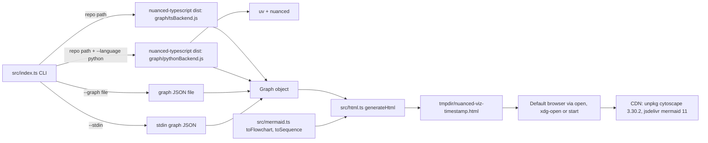
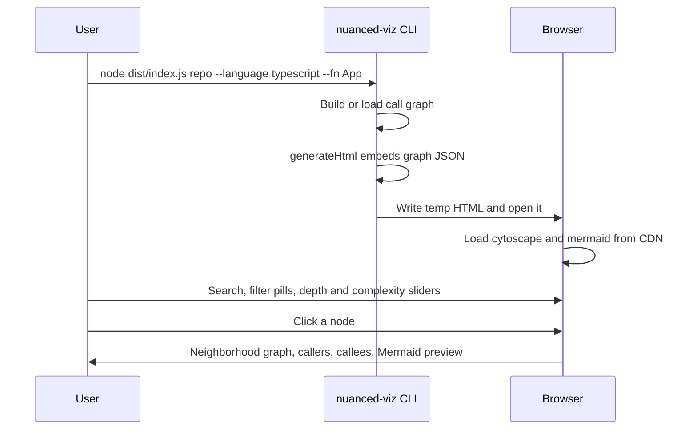

# nuanced-viz

Interactive browser visualizer for [nuanced-mcp](https://github.com/eminogrande/nuanced-mcp-typescript) call graphs.
A Node.js CLI builds or loads a call graph and writes one self-contained HTML file with cytoscape.js and mermaid.js.
For developers and agents who want to explore how functions in a TS/JS or Python repo call each other.

## Logs

- [CHANGELOG.md](CHANGELOG.md): release notes per version, newest first
- [PROMPTLOG.md](PROMPTLOG.md): rules and prompts that shaped this repo

## Status

| Field | Value |
|-------|-------|
| Version | v0.1.0 (package.json `0.1.0`) |
| Date | 2026-10-14 |
| Updated by | hermes-agent for emino |
| Default branch HEAD | `df844ca` (main) |
| Deployment | not documented in repo. Local CLI only. A GitHub Pages deploy is proposed in open PR #1, not merged. |

## What it does

- Builds a call graph from any TypeScript/JavaScript or Python repo
- Generates a self-contained HTML file with [cytoscape.js](https://js.cytoscape.org/) + [mermaid.js](https://mermaid.js.org/)
- Writes it to the OS temp dir as `nuanced-viz-<timestamp>.html` and opens it in your default browser
- No server, no port, no daemon. Just a file.

## Architecture



## User flow



## Components

| Component | Path | Role |
|-----------|------|------|
| CLI entry | `src/index.ts` | Parses args, builds or loads graph, writes HTML, opens browser |
| HTML generator | `src/html.ts` | `generateHtml(graph, repoPath, initialFn)`: page, CSS, client-side JS |
| Mermaid converter | `src/mermaid.ts` | `Graph` types, `toFlowchart`, `toSequence` |
| Self-check tests | `src/test/selfcheck.test.ts` | `node:test` checks on generated HTML: labels, zoom, layout, Mermaid view |
| Build config | `tsconfig.json` | ES2022, node16 modules, `src` to `dist` |
| Package | `package.json` | bin `nuanced-viz` -> `dist/index.js`, dependency `ts-morph` |

## API / Endpoints

CLI only. No HTTP routes, no MCP tools.

| Command / flag | Purpose |
|----------------|---------|
| `nuanced-viz <repo-path>` | Build a graph from a repo (positional) |
| `-l, --language <lang>` | `typescript` or `python` (default: `typescript`) |
| `-f, --fn <name>` | Function to focus on initially |
| `-g, --graph <file>` | Load a pre-built graph JSON instead of building one |
| `--stdin` | Read graph JSON from stdin |
| `-h, --help` | Show help |

## Install

```bash
git clone https://github.com/eminogrande/nuanced-viz.git
cd nuanced-viz
npm install && npm run build
```

Requires Node.js >= 22 (the graph builders use `fs.globSync`). For Python repos, also needs `uv` on PATH.

Repo mode (`<repo-path>`) imports the graph builders from a hardcoded path: `~/Developer/nuanced-typescript/dist` (`NUANCED_MCP_DIST` in `src/index.ts`). That checkout must exist and be built. `--graph` and `--stdin` do not need it.

## Run

| Script | Command |
|--------|---------|
| build | `npm run build` (tsc) |
| start | `npm start` (node dist/index.js) |
| test | `npm test` (node --test dist/test/selfcheck.test.js, run after build) |

Env vars: none read by the code.

## Usage

```bash
# Build a graph from a repo and visualize it
node dist/index.js /path/to/repo --language typescript
node dist/index.js /path/to/repo --language typescript --fn App

# Load a pre-built graph JSON (from nuanced-mcp tools or elsewhere)
node dist/index.js --graph graph.json --fn mainFunction

# Pipe graph JSON from stdin
cat graph.json | node dist/index.js --stdin
```

## Browser UI

### Toolbar

- Search box, depth slider (1 to 10, default 3), diagram type select, Recenter button
- Complexity slider: hides low-importance functions (0 = show all, 100 = only hubs)

### Cytoscape canvas (left)

- Interactive graph with pan, native wheel zoom, and drag
- Rooted caller-to-callee hierarchy (breadthfirst) with overlap-aware spacing
- Compact labels and bounded automatic zoom keep dense neighborhoods readable
- Click a node to select it and see its depth-limited neighborhood
- Only renders the neighborhood around the selected node (up to 300 nodes) to stay responsive on large codebases

### Sidebar (right)

Two tabs:

**Function Index**
- Stats bar and color legend (click a legend entry to toggle its group)
- All functions grouped by file, collapsible
- Per-file and per-function checkboxes to toggle visibility in the graph (items stay in the list, greyed out, so you can toggle them back)
- Search box filters the index live

**Details**
- Selected function's file, line, call count
- Clickable callees and callers lists (hover to highlight in the canvas)
- Live Mermaid preview of the selected function's subgraph (flowchart or sequence, switchable, capped at 50 nodes)
- Left-to-right flowcharts at readable size with scrolling and a full-screen expanded view

### Filter toolbar

- Auto-derived category pills based on the repo's directory structure
- Each pill toggles a group of functions on/off in the graph
- Toggling rerenders the graph with a fresh layout

### Auto-derived categories

Categories are **not hardcoded**. The tool scans the repo's directory structure and creates a group per top-level or second-level source directory (e.g. `services/bitcoin`, `lib`, `components`). Sparse subdirectories merge into their parent. Generic categories (Setters, Builtins, Anonymous) are always detected. Everything else falls into "Other".

This means it works on any repo:
- [nuri-expo](https://github.com/eminogrande/nuri-expo) (8337 functions, 542 files)
- [arkade-os/ts-sdk](https://github.com/arkade-os/ts-sdk) (7414 functions, 266 files, monorepo)
- Any TS/JS or Python repo

## How it works

1. **Graph building**: reuses the graph modules from [nuanced-mcp-typescript](https://github.com/eminogrande/nuanced-mcp-typescript) (ts-morph for TS/JS, `uv` + `nuanced` for Python)
2. **HTML generation**: embeds the graph JSON + cytoscape.js + mermaid.js (CDN) into a single self-contained HTML file
3. **Browser rendering**: all interactivity is client-side JS. The graph data is embedded at generation time. No round-trips to a server.

## License

MIT
